# 双缓冲（Double Buffering）SGEMM 学习笔记

> 日期：2026-11-12
> 关联文件：`src/kernels/double_buffer_sgemm.cuh`、`tiled_sgemm.cuh`
> 前置知识：tiled_sgemm（数据复用 + 合并访问）、共享内存 bank 机制

---

## 一、定位：双缓冲解决什么问题

优化链条：`naive → tiled → bank-conflict-free → double-buffer → register-tiling → tensor-core`

| 版本 | 解决的问题 |
|------|-----------|
| naive | 无数据复用、读取次数爆炸 |
| tiled | 共享内存 tile：数据复用 + 合并访问 |
| bank-conflict-free | 加 padding 消除 bank conflict |
| **double-buffer** | **重叠访存与计算，隐藏全局内存延迟** |

tiled 版本留下的问题：每个 tile 的执行是**严格串行**的：

```
[Load tile] → [Sync] → [Compute tile] → [Sync] → [Load tile] → ...
```

**加载时 FMA 单元闲着，计算时访存单元闲着**，全局内存的高延迟被完全暴露。

---

## 二、核心思想：软件流水线（Software Pipelining）

准备**两组**共享内存缓冲区 `As[2]`、`Bs[2]`，让"加载下一 tile"与"计算当前 tile"同时进行。

```mermaid
gantt
    title 双缓冲流水线时序（tile 级）
    dateFormat X
    axisFormat %s
    section 访存单元
    Load T0 :a0, 0, 1
    Load T1 :a1, 1, 2
    Load T2 :a2, 2, 3
    section FMA单元
    Compute T0 :c0, 1, 2
    Compute T1 :c1, 2, 3
```



从 tile 1 起，**加载总是和上一轮的 compute 重叠**，访存延迟被藏进计算时间。

### 易混淆：tile 有两层含义

1. **输出 tile（block 级，固定）**：每个 block 负责 C 的一个 `32×32` 块，全程不变。
2. **输入 tile（循环级，沿 K 滑动）**：循环每次迭代从 A、B 各取一个 `32×32` 子块，沿 K 方向逐段处理。

$$
C_{\text{block}} = \sum_{t=0}^{\text{numTiles}-1} A_t \cdot B_t
$$

---

## 三、慢的本质：为什么"串行"就慢

1. **两种硬件资源交替空闲**：加载用访存单元（LD/ST），计算用 FMA 流水线，串行时任一时刻只有一种在干活。
2. **全局内存高延迟被暴露**：DRAM 延迟几百个时钟周期，`__syncthreads()` 后所有线程干等数据到达。

---

## 四、具体实现拆解

### 4.1 双份 buffer（硬件基础）

```cuda
__shared__ float As[2][TILE_SIZE][TILE_SIZE + 1];  // +1 是 padding，消 bank conflict
__shared__ float Bs[2][TILE_SIZE][TILE_SIZE + 1];
```

必须有**两块物理空间**，否则"预取下一块"会覆盖"正在计算的这一块"。

### 4.2 乒乓切换

```cuda
int writeBuffer = 0;
int readBuffer = 0;

for (int t = 0; t < numTiles; ++t) {
    readBuffer = writeBuffer;        // 上一轮写的 buffer 这一轮拿来读
    writeBuffer = 1 - writeBuffer;   // 翻转到另一块
```

`1 - writeBuffer` 实现 `0 ↔ 1` 轮转。

### 4.3 重叠的关键：预取写 w、计算读 r

```cuda
    if (t + 1 < numTiles) {
        As[writeBuffer][ty][tx] = A[row * K + aCol];   // ③ 预取 → 写 writeBuffer
        Bs[writeBuffer][ty][tx] = B[bRow * N + col];
    }

    for (int k = 0; k < TILE_SIZE; ++k)               // ④ 计算 → 读 readBuffer
        sum += As[readBuffer][ty][k] * Bs[readBuffer][k][tx];

    __syncthreads();
}
```

③ 和 ④ 访问**不同的物理 buffer**，没有数据依赖，可以并行/乱序执行——这就是重叠的来源。

### 4.4 单道 `__syncthreads()` 的作用

挡住"下一轮预取覆盖"，保护"本轮读取"：

- 第 t 轮读 `r`、写 `w`；第 t+1 轮读 `w`、写 `r`（要覆盖旧的 r）。
- 屏障保证"所有线程读完 r 之后"，才进入下一轮写 r。

tiled 需要两道屏障（写→读、读→写各一道），double-buffer 因为读写分家，**一道就够**。

### 4.5 流水线启动与排空

- **启动（prologue）**：预加载 tile 0，因为第一轮没有"更早的计算"来藏它的加载延迟。
- **排空（epilogue）**：`if (t + 1 < numTiles)` 跳过最后一块的预取。

---

## 五、"并行"的准确含义

**不是两条 C++ 语句并行，而是"数据传输"与"计算"两个物理过程重叠。**

`As[writeBuffer][ty][tx] = A[...]` 编译成两条指令：

```asm
LDG  R0, [A + offset]        ; ① 发起全局 load（瞬间）
STS  [As + offset], R0       ; ② 写共享内存（依赖 ①，数据到了才执行）
```

- ① 只是"发出请求"，数据要几百 cycle 才到寄存器。
- ② 依赖 ①，编译器会把后面的计算（读 r）插到 ① 和 ② 之间。
- 计算读的是 `readBuffer`（旧数据，早已就绪），不依赖 ①，所以立即执行。

```
① LDG 发起 → [ 数据在 DRAM 上传输几百 cycle ] → ② STS 完成
              └── 这段时间被 ④ 的计算占满 ──┘
```

---

## 六、关键澄清：`__syncthreads()` 阻塞什么

**阻塞的是"线程的执行进度"，不是"计算"或"加载"这种操作类别。**

- 它的语义：等 block 内所有线程执行到这一行。
- 在本代码中的实际效果：**挡住下一轮预取写入，保护本轮计算读取**。
- 不是"屏障阻塞加载"，而是反过来：**加载太慢会拖累屏障**（线程卡在 STS，到不了屏障）。

---

## 七、r / w 是轮转的角色，不是固定地址

| 轮次 | readBuffer 指向 | writeBuffer 指向 |
|------|----------------|-----------------|
| t=0 | buffer 0 | buffer 1 |
| t=1 | **buffer 1** | buffer 0 |
| t=2 | buffer 0 | buffer 1 |

`readBuffer = writeBuffer` 这行 = "上一轮的 w 变成这一轮的 r"。所以"读 w"实际是"下一轮读上一轮写的那块"。

---

## 八、边界条件：菜炒完食材没到

双缓冲隐藏延迟是**有条件**的：

| 情况 | 结果 |
|------|------|
| 计算时间 ≥ 加载时间 | 延迟被完全隐藏 |
| 计算时间 < 加载时间 | 计算做完，STS 还在等数据，`__syncthreads()` 阻塞 → 延迟暴露 |

计算 < 加载时，卡住的**不是读，是 STS（写下一块）**。

解决办法（后续优化的动机）：
1. **提高算术强度**：register tiling，每线程算 4×4 = 16 个元素，让"炒菜时间"变长。
2. **提高 occupancy**：更多并发 warp，本 block 流水线断了就切别的 warp 顶上。

---

## 九、硬件机制保证正确执行

软件/硬件分工：

| 正确性要求 | 谁负责 | 机制 |
|-----------|--------|------|
| STS 不读取未就绪的 LDG 数据 | 纯硬件 | scoreboard 依赖跟踪，自动 stall |
| 读 readBuffer 时数据必已写完 | 软件声明 + 硬件落实 | `__syncthreads()` + 内存屏障语义 |
| 读旧 buffer 不会重读 | 纯软件结构 | 循环编译期展开，PC 只前进不回退 |
| warp 等待时不空转 | 纯硬件 | 调度器切到其他 warp |

**关键认知**：硬件保证的是"你声明的约束一定被满足"，而不是"你的程序一定正确"。正确声明约束（双 buffer 编排 + 屏障位置）永远是程序员的责任。

### 为什么"等待"不会变成"重复读"

- 指令是单向顺序推进的，PC 只前进、不回退。
- 循环展开成固定 32 条 `LDS + FMA`，读 32 次，一次不多不少。
- stall = 冻结在 STS 上，不是跳回循环头重读。

---

## 十、数据竞争：删掉 `__syncthreads()` 会怎样

### 屏障 A（预加载后）

每个线程只写自己那一格，但计算要读**整行/整列**（别人的数据）。没有屏障 → **读到他人未写入的垃圾值**。

### 屏障 B（循环内）：两类竞争

| 竞争 | 依赖被破坏 | 后果 |
|------|-----------|------|
| 读到未写完的 w | 写→读（t 轮写 w，t+1 轮读 w） | 读到未完成的数据 |
| 读到被覆盖的 r | 读→写（t 轮读 r，t+1 轮覆盖 r） | 快线程把 r 改成 tile t+2，慢线程还在读 tile t → 张冠李戴 |

**本质**：tile 是"一批线程各写一部分、再一起读整块"，没有屏障就失控了。

> 注意：这是未定义行为，"碰巧不错"只是侥幸，换 GPU 或调度顺序就崩。

---

## 十一、数据复用：旧 buffer 会重复读吗

分三个层面：

1. **单线程内**：不重复。k 从 0 到 31 遍历不同位置，每个元素只读一次。
2. **线程之间**：会重复，且是刻意的。
   - `As[ty][k]` 被同一行 32 个线程（tx=0..31）各读一次 → 行广播
   - `Bs[k][tx]` 被同一列 32 个线程（ty=0..31）各读一次 → 列广播
   - 这就是"数据复用"：全局内存加载 1 次，共享内存被读 32 次。
3. **物理 buffer**：乒乓复用，但每次读的是新 tile 数据，不是旧数据。

---

## 十二、进阶：寄存器分块（Register Tiling）

`double_buffer_register_tiled_sgemm_kernel` 在双缓冲上再叠一层：

1. 每线程算 `4×4` 子矩阵，累加器放寄存器 `regC[4][4]`。
2. 内层读 `regA[4]` + `regB[4]`（8 次 load）做 16 次 FMA → 算术强度翻倍。
3. 协作加载：线程数少于 tile 元素数，用 stride 循环加载多个元素。
4. `static_assert` 防止 `TILE_SIZE=64` 超出 48KB 静态共享内存上限。

---

## 十三、一句话总结

> **`As[2]` 提供空间，`1 - writeBuffer` 负责轮转，"预取写 writeBuffer、计算读 readBuffer"制造重叠，末尾单道 `__syncthreads()` 保证轮转安全。** 双缓冲不是消除"加载"和"计算"的顺序，而是让相邻两个 tile 的加载与计算在时间上错开重叠，把全局内存的几百 cycle 延迟藏进计算时间里。
